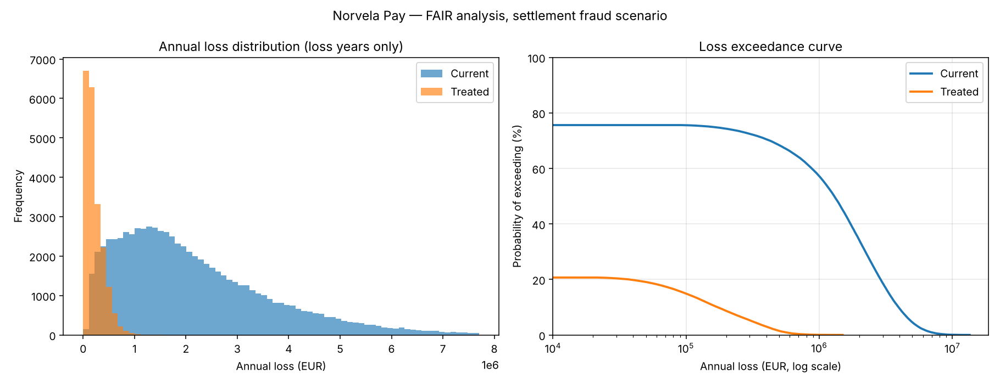

<div align="center">

# The Norvela GRC Lab

**A self-hosted, 12-week lab where you learn governance, risk and compliance by assessing one fictional EU payment institution from start to finish.**

[](LICENSE)


[Start here](#-start-here) · [Programme](#-the-programme) · [Lab stack](#-lab-stack) · [Repository layout](#-repository-layout) · [PDF manual](docs/Norvela-GRC-Lab-Manual.pdf) · [**Live progress tracker**](https://bakroot.github.io/norvela-grc-lab/)

</div>

---

<!-- manual:start -->
You assess **Norvela Pay, S.A.**, a fictional authorised payment institution in Lisbon with 340 staff, four legal entities, 20 third parties and **46 planted findings**. The work covers everything a GRC analyst does on a real engagement: risk assessment, scoping, control testing, third-party risk, a DORA Register of Information, a live incident, reporting to the board, and turning it all into interview material. It runs for twelve weeks at about eight hours a week.

Every phase ends in an **artefact a stranger could read**, so by the end you have a portfolio to show: a Statement of Applicability, a Register of Information, an incident classification memo and a quantified investment case.
<!-- manual:end -->

> [!NOTE]
> **Fiction notice.** Norvela Pay, its people, its vendors (except where real products are named as tooling), its licence number, its incident and its supervisory correspondence are all fictional. The tools and regulations are real and named accurately. When you put this work in a portfolio, say it is a lab.

---

## 🧭 Start here

```bash
git clone https://github.com/BAKROOT/norvela-grc-lab.git
cd norvela-grc-lab
```

1. **[`02-stack/SETUP.md`](02-stack/SETUP.md)**: build the lab. It takes one evening (about 3 hours, mostly downloads).
2. **[`01-scenario/00-COMPANY-DOSSIER.md`](01-scenario/00-COMPANY-DOSSIER.md)**: read up on the company you are assessing.
3. **[`CURRICULUM.md`](CURRICULUM.md)**: the programme. Work the phases in order.
4. **[Progress tracker](https://bakroot.github.io/norvela-grc-lab/)**: tick off steps as you go (hosted on GitHub Pages from [`docs/logbook.html`](docs/logbook.html)). Progress is saved in your browser only.

> [!WARNING]
> Do **not** open [`01-scenario/99-FINDINGS-KEY.md`](01-scenario/99-FINDINGS-KEY.md) until you have finished Phase 3. The lab is only worth doing if you find the findings yourself.

---

## 🗺️ The programme

| Phase | Weeks | Focus | Deliverable |
|---|---|---|---|
| **P0** | 1 | Set up and orient | Day-3 observations memo to the CEO |
| **P1** | 2–3 | Governance and risk foundations | Rebuilt risk register, scoring criteria, risk appetite, governance pack |
| **P2** | 4 | Scoping and the Statement of Applicability | Five scope statements (ISMS, PCI, DORA, NIS2/RJC, AI Act) and a full SoA covering all 93 controls |
| **P3** | 5–6 | Control assessment and evidence | 20 tested controls with workpapers, and an evidence library |
| **P4** | 7–8 | Third-party risk and the DORA RoI | Register of Information, data-quality statement, concentration paper |
| **P5** | 9 | Incident, continuity, regulatory clock | Incident pack (7 deliverables), BIA, revised IRP and BCP |
| **P6** | 10 | Reporting, audit and the board | Internal audit, management review, KRIs, one-page board paper, FAIR case |
| **P7** | 11–12 | Interview conversion | Portfolio, bank of STAR stories, timed case studies |

Each phase ends with a **proof gate**, a test that shows whether you actually learned the material or only read it. Full detail is in [`CURRICULUM.md`](CURRICULUM.md).

---

## 🧪 Lab stack

Everything runs on one laptop: 8 GB RAM for the base profile, 16 GB with vulnerability scanning.

| Component | Role in the programme | Where |
|---|---|---|
| [CISO Assistant](https://github.com/intuitem/ciso-assistant-community) | GRC platform: risk register, SoA, audits, evidence, cross-mapping between frameworks | `https://localhost:8443` |
| [Prowler](https://github.com/prowler-cloud/prowler) | Cloud configuration checks mapped to CIS, ISO 27001, NIS2 and more | CLI |
| [OpenSCAP](https://www.open-scap.org/) | Host hardening scans that produce timestamped audit evidence | CLI |
| OpenSearch + Dashboards | Evidence store; write the query that would have caught the incident | `:9200` / `:5601` |
| OWASP Juice Shop / DVWA | Targets that really do fail controls | `:3000` / `:8081` |
| Greenbone GVM / OpenVAS | Authenticated vulnerability scanning *(optional profile)* | `:9392` |
| Mailpit | Catches alerts, which proves a control fired rather than just exists | `:8025` |
| [`fair_analysis.py`](02-stack/tools/fair_analysis.py) | FAIR Monte Carlo loss model that turns a heat map into an investment case | Python |

```bash
cd 02-stack
docker compose up -d                       # targets, log estate, mail sink
docker compose --profile scanning up -d    # + GVM (heavy, first feed sync 30–60 min)
bash tools/healthcheck.sh                  # verify
```

<details>
<summary><b>Sample output: FAIR analysis of the settlement-fraud scenario</b></summary>
<br>



The chart compares annual losses with current controls against losses after treatment (short-lived credentials, egress allow-listing, anomaly detection). The treatment lowers *vulnerability* and *loss magnitude*. It does not lower threat event frequency, and the lab teaches you to defend that point.

</details>

---

## 📁 Repository layout

```
norvela-grc-lab/
├── CURRICULUM.md                      The programme: 8 phases, steps, deliverables, proof gates
├── 01-scenario/
│   ├── 00-COMPANY-DOSSIER.md          The company: governance, estate, data, vendors, pressures
│   ├── 10-INCIDENT.md                 NOR-2026-0908: a live incident with 10 timed decision points
│   └── 99-FINDINGS-KEY.md             46 planted findings with framework mappings (spoilers)
├── 02-stack/
│   ├── SETUP.md                       Build instructions, 6 parts, ~3 hours
│   ├── docker-compose.yml             Targets, log estate, scanning profile
│   └── tools/
│       ├── api-examples.sh            CISO Assistant REST API: domain, perimeters, asset import
│       ├── fair_analysis.py           FAIR Monte Carlo risk quantification
│       └── healthcheck.sh             Verify the lab
├── 03-workbooks/
│   ├── risk-register.xlsx             Inherited register, V2 template, scoring criteria, appetite
│   ├── dora-register-of-information.xlsx   RoI working template shaped like the ITS tables, with a how-to
│   ├── vendors.csv                    20 third parties, each with real problems
│   ├── assets.csv                     24 assets drawn from 3 inventories that disagree
│   ├── iam-users.csv                  128 identities with 8 planted access findings
│   ├── vuln-findings.csv              1,247 findings; all 38 criticals are older than 180 days
│   └── build_workbooks.py             Regenerates all of the above (deterministic)
├── 04-evidence/                       Scenario artefacts + your Phase 3 evidence library
├── 05-interview/
│   ├── QUESTION-BANK.md               120 questions across 6 categories
│   └── CASE-STUDIES.md                6 timed cases in real interview formats
└── docs/
    ├── Norvela-GRC-Lab-Manual.pdf     Print edition of the whole lab
    ├── Norvela-GRC-Lab-Findings-Key.pdf   Findings key, kept separate so you don't see it early
    ├── logbook.html                   Interactive progress tracker (served on GitHub Pages)
    ├── index.html                     Pages entry point → logbook.html
    └── build_pdfs.py                  Rebuilds both PDFs from the Markdown
```

---

## 🧱 Why it's built this way

<!-- manual:start -->
**One company, not many exercises.** Real GRC work builds on itself: your scoping decision in week 4 constrains your control testing in week 6. Isolated exercises never teach that. Living inside one organisation for twelve weeks does.

**Deliberately broken, deliberately realistic.** Norvela is not a disaster zone. It is a normal, competent, fast-growing company that has built up the usual debt, half-finished processes and gaps between teams. Its Poland entity runs a separate HR system, and that is not an exotic failure. It is *the* most common root cause of leaver-process gaps in firms with several legal entities.

**Multi-regulation on purpose.** DORA, NIS2, GDPR, PCI DSS, ISO 27001, SOC 2 and the EU AI Act all apply at once. Handling that overlap is the actual job. One MFA control is evidence for six regimes, but a control that maps to a requirement does not satisfy every regime equally.

**Artefacts, not notes.** Every phase ends with something a stranger could read. Reading gives you the feeling of learning. Writing produces the thing.
<!-- manual:end -->

---

## 📅 Regulatory currency

<!-- manual:start -->
The dates and framework states in this lab were checked in **September 2026**:

- **DORA** (Reg. EU 2022/2554) has applied since 17 January 2025. The Register of Information is submitted once a year through national competent authorities.
- **NIS2 in Portugal**: Decreto-Lei 125/2025 (Regime Jurídico da Cibersegurança) has been in force since 3 April 2026. CNCS is the lead authority and CERT.PT the national CSIRT.
- **ISO/IEC 27001**: the 2013→2022 transition closed on 31 October 2025. Amendment 1:2024 adds a climate-change determination at Clause 4.1.
- **EU AI Act**: Art. 50 transparency obligations apply from 2 August 2026. The Digital Omnibus (Reg. EU 2026/1744) moved Annex III high-risk obligations to 2 December 2027 and Annex I to 2 August 2028.

**Check a date before you cite it.** Regulation moves faster than any lab, and the habit of checking instead of reciting is part of the professional skill this lab teaches.
<!-- manual:end -->

---

## 🛠️ Regenerating the data and PDFs

```bash
pip install openpyxl numpy matplotlib markdown weasyprint
python3 03-workbooks/build_workbooks.py   # CSVs + workbooks (fixed seed → identical output)
python3 docs/build_pdfs.py                # Manual + Findings Key PDFs from the Markdown
```

See [`CHANGELOG.md`](CHANGELOG.md) for what changed between releases.

---

## 👤 Author

**Bilal Ahmad Kamal**: penetration tester, GRC practitioner and PhD researcher in cybersecurity (Universidade de Coimbra / CISUC).

[](https://linkedin.com/in/bilalspeaks)
[](https://github.com/BAKROOT)

Related repositories: [Cybersecurity-GRC-Compliance](https://github.com/BAKROOT/Cybersecurity-GRC-Compliance) · [it-general-controls-101](https://github.com/BAKROOT/it-general-controls-101) · [risk-management-knowledge-base](https://github.com/BAKROOT/risk-management-knowledge-base) · [VAPT-Penetration-Testing-Framework](https://github.com/BAKROOT/VAPT-Penetration-Testing-Framework)

## 📄 License

Released under the [MIT License](LICENSE). If you use the lab for teaching or training, please cite it (see [`CITATION.cff`](CITATION.cff)).

Third-party tools in the stack keep their own licences. CISO Assistant Community Edition, for example, is AGPL-3.0. This repository does not redistribute any of them.
